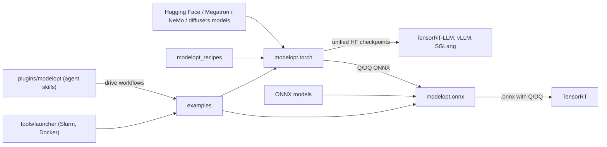
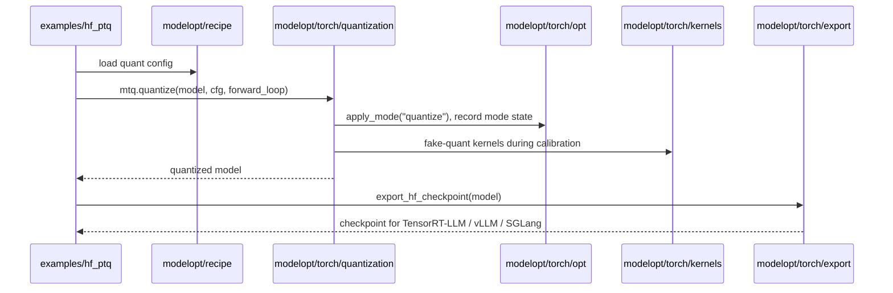

# Architecture: NVIDIA Model Optimizer (ModelOpt)

Fork-only doc (`agent-main`). Upstream user docs are in `docs/source`.

## Purpose

- Compress models for faster and smaller inference on NVIDIA GPUs, with a small loss of accuracy.
- Techniques: quantization (PTQ, QAT, QAD), pruning and NAS, distillation, sparsity, speculative decoding draft models, PEFT.
- Input: PyTorch models (Hugging Face, Megatron, NeMo, diffusers) or ONNX models.
- Output: unified Hugging Face checkpoints for TensorRT-LLM, vLLM and SGLang (`modelopt/torch/export`), or Q/DQ and mixed-precision ONNX for TensorRT (`modelopt/onnx`).
- One mode system (`modelopt/torch/opt`) records each optimization so models can be saved, restored and stacked.
- Ready recipes (`modelopt_recipes`) and end-to-end scripts (`examples`) for common models.

## Inter: interaction with other systems

## Components

| Component | Purpose |
|-----------|---------|
| `modelopt/torch/opt` | Mode system: `apply_mode`, save/restore, config base classes, searcher |
| `modelopt/torch/quantization` | PyTorch quantization and calibration (see its `README.md`) |
| `modelopt/torch/export` | Export quantized HF, diffusers and Megatron models to unified HF checkpoints; deprecated TensorRT-LLM checkpoint export in `trtllm/` (see its `README.md`) |
| `modelopt/torch/nas`, `modelopt/torch/prune` | NAS and pruning |
| `modelopt/torch/puzzletron` | Puzzletron architecture search and compression |
| `modelopt/torch/distill` | Knowledge distillation |
| `modelopt/torch/sparsity` | Weight and attention sparsity |
| `modelopt/torch/speculative` | Speculative decoding draft models (EAGLE, Medusa, and others) |
| `modelopt/torch/peft` | LoRA and other PEFT methods |
| `modelopt/torch/fastgen` | Diffusion step-distillation losses |
| `modelopt/torch/kernels` | CUDA and Triton kernels for quantization and sparsity (see its `README.md`) |
| `modelopt/torch/models` | Per-model descriptors for Hugging Face model types |
| `modelopt/torch/trace` | Layer dependency analysis |
| `modelopt/torch/_deploy` | Benchmark models and convert them to device binaries |
| `modelopt/torch/utils` | Shared utilities, plugin import helpers |
| `modelopt/onnx/quantization` | ONNX PTQ to Q/DQ ONNX (see its `README.md`) |
| `modelopt/onnx/autocast` | Convert FP32 ONNX to FP16/BF16 mixed precision (see its `README.md`) |
| `modelopt/onnx/graph_surgery`, `modelopt/onnx/export` | ONNX graph post-processing and export helpers |
| `modelopt/deploy` | LLM generation helpers for deployment |
| `modelopt/recipe`, `modelopt_recipes` | Recipe loader and YAML recipes for models and formats |
| `examples` | End-to-end scripts (for example `examples/hf_ptq`, `examples/onnx_ptq`, `examples/llm_qat`) |
| `plugins/modelopt` | Installable agent plugin: skills and agents |
| `tools` | CI, launcher, debugger, MCP, pre-commit helpers |
| `experimental` | Experimental features not in the main package |
| `tests` | `unit` (CPU), `gpu*` (GPU and framework-specific), `examples`, `regression` |
| `.fork` | Fork-only notes for agents (branches, known failures on Thor) |

## Intra: interaction between components

Typical LLM PTQ flow (`examples/hf_ptq/hf_ptq.py`):

## Key integration tests

| Test | What it proves |
|------|----------------|
| `tests/examples/hf_ptq/test_llm_ptq.py` | LLM PTQ and export through the example script |
| `tests/examples/test_onnx_ptq.sh` | ONNX PTQ example |
| `tests/examples/torch_onnx/test_torch_quant_to_onnx.py` | PyTorch quantization to Q/DQ ONNX |
| `tests/examples/llm_qat` | QAT example |
| `tests/examples/llm_distill` | Distillation example |
| `tests/examples/speculative_decoding` | Draft model training example |
| `tests/gpu/torch/quantization/test_quantize_cuda.py` | Quantization with CUDA kernels |
| `tests/unit/onnx/quantization/test_quantize_api.py` | ONNX quantization API |
| `tests/regression` | Regression tests |

Thor test setup and expected failures: `.fork/known_failures.md`.
