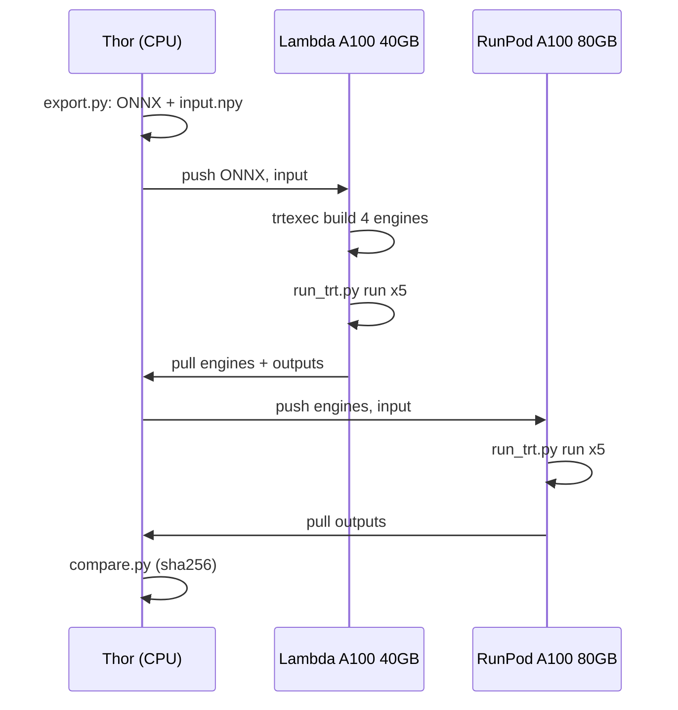

# TensorRT engine bit-exactness: A100 40GB vs A100 80GB

Independent experiment. It is not part of ModelOpt and is not for merge.

**Question:** a TensorRT engine is built on an A100-SXM4-40GB. Does it give the same output bits
on an A100-SXM4-80GB?

**Answer:** yes. All 4 engines (ResNet-50 and DINOv2 ViT-B/14, FP32 and FP16) give bit-exact
outputs on both GPUs, and bit-exact outputs run to run (5 runs) on each GPU.

## Results

| Engine | Output | 5 runs equal on 40GB | 5 runs equal on 80GB | 40GB vs 80GB |
|---|---|---|---|---|
| resnet50_fp32 | 8x1000 | yes | yes | bit-exact |
| resnet50_fp16 | 8x1000 | yes | yes | bit-exact |
| dinov2_vitb14_fp32 | 8x257x768 | yes | yes | bit-exact |
| dinov2_vitb14_fp16 | 8x257x768 | yes | yes | bit-exact |

Full output: [results/compare.md](results/compare.md). Hashes of each engine and each run's output:
`results/<gpu>/meta.json`.

Sanity check against PyTorch FP32 on CPU (same input), so that "equal" does not mean "empty":

| Engine | Max abs diff | Mean abs diff |
|---|---|---|
| resnet50_fp32 (TF32) | 0.0072 | 0.0007 |
| resnet50_fp16 | 0.014 | 0.0012 |
| dinov2_vitb14_fp32 (TF32) | 1.18 | 0.0020 |
| dinov2_vitb14_fp16 | 4.43 | 0.021 |

All outputs are finite. The FP16 engines differ from the FP32 engines, so FP16 kernels did run.

## Setup

| | Build + run 1 | Run 2 |
|---|---|---|
| GPU | NVIDIA A100-SXM4-40GB (40960 MiB) | NVIDIA A100-SXM4-80GB (81920 MiB) |
| Provider | Lambda Cloud, `gpu_1x_a100_sxm4`, asia-south-1 | RunPod, Secure Cloud |
| Driver | 570.148.08 | 595.91.07 |
| Container | `nvcr.io/nvidia/tensorrt:24.12-py3` | same |
| TensorRT | 10.7.0 | 10.7.0 |

- Models: torchvision ResNet-50 (`IMAGENET1K_V2`) and `facebook/dinov2-base` (last hidden state).
- ONNX: exported on Thor CPU, opset 17, static batch 8, 3x224x224 (`export.py`).
- Input: one fixed tensor, `np.random.default_rng(0).standard_normal`, float32.
- Engines: `trtexec --onnx ... --saveEngine ...`, plus `--fp16` for FP16. FP32 keeps TensorRT's
  default TF32. Built once on the 40GB GPU; the same files (same sha256) ran on the 80GB GPU.
- Run: polygraphy `TrtRunner`, 5 inferences per engine; sha256 of the output bytes per run.



## What this does and does not show

- Shows: one engine file is deterministic and bit-exact across the two A100 memory sizes, two
  drivers (570 and 595) and two cloud hosts. Both GPUs are sm_80 with 108 SMs, so the tactics
  chosen at build time run the same way.
- Does not show: engines built separately on each GPU match. Tactic timing at build time can pick
  different kernels, which can change the bits. Not tested here.
- Not tested: dynamic shapes, INT8, other batch sizes, real images.

## Cost

| Item | USD |
|---|---|
| Lambda A100 40GB, build + run (42 min at $1.99/hr) | 1.41 |
| RunPod A100 80GB, run (20 min at $1.79/hr, mostly upload) | 0.61 |
| RunPod pods lost to setup bugs and a dropped host (3 pods) | 1.98 |
| Total | 4.00 |

RunPod had no A100 40GB for about 8 hours, so the 40GB stage used Lambda Cloud.

## Run it again

Uses the `gpu` CLI from `gpu-rent` (profile `trtexact`) on Thor.

```bash
python experiments/trt-bit-exact-a100/export.py ~/trt-exact-work
setsid nohup experiments/trt-bit-exact-a100/pipeline.sh > ~/trt-exact-work/pipeline.log 2>&1 &
python experiments/trt-bit-exact-a100/compare.py ~/trt-exact-work/results  # the pipeline also runs it
```
