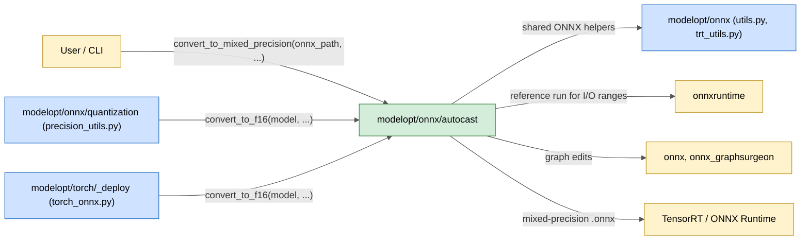
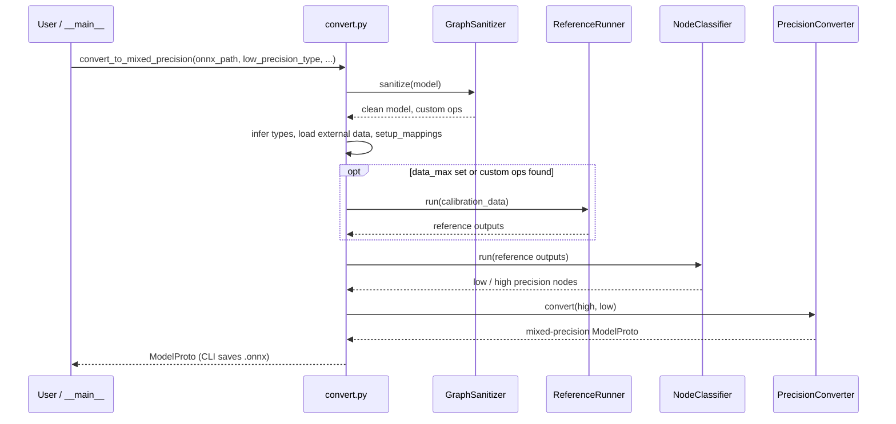

# modelopt/onnx/autocast

AutoCast: converts an FP32 ONNX model to mixed precision (FP16 or BF16). Nodes that are safe run in low precision. Nodes that can overflow or lose accuracy stay in FP32.

## Purpose

- Convert an FP32 ONNX model to `fp16` or `bf16` mixed precision (`convert_to_mixed_precision()`).
- Keep risky nodes in FP32 by rules: node-name regex, op type, initializer range (`init_max`), I/O value range from a reference run (`data_max`), depth of reduction, or a custom `NodeRuleBase` rule.
- Force nodes into low precision by node-name regex or op type (include rules).
- Run the model with ONNX Runtime (CPU, CUDA or TensorRT execution providers) to get reference I/O ranges, with random or user calibration data.
- Clean the graph before conversion: opset upgrade (default minimum 13 for `fp16`, 22 for `bf16`), LayerNorm pattern fusion, shared-constant duplication, custom-op handling, FP64 to FP32.
- Insert `Cast` nodes at precision borders and optionally keep the network I/O types (`keep_io_types`).
- Give a light conversion path for other ModelOpt flows (`convert_to_f16()`): a fixed op block list, no node classifier, no reference run.
- CLI: `python -m modelopt.onnx.autocast`.

## Inter: interaction with other systems

## Components

| Component | Purpose |
|-----------|---------|
| `convert.py` | Public API: `convert_to_mixed_precision()` (full flow) and `convert_to_f16()` (block-list flow, used by other modules) |
| `__main__.py` | CLI for `convert_to_mixed_precision()` |
| `graphsanitizer.py` | `GraphSanitizer`: opset and IR version, LayerNorm fusion, shared constants, custom ops, I/O casts, FP64 to FP32 |
| `nodeclassifier.py` | `NodeClassifier` and rules (`DisabledNodeNameRegexRule`, `DisabledOpTypes`, `InitializerRangeRule`, `IORangeRule`, `DepthOfReductionRule`, include rules): split nodes into low and high precision |
| `referencerunner.py` | `ReferenceRunner`: run the model with ONNX Runtime and collect output tensors or `TensorStats` |
| `precisionconverter.py` | `PrecisionConverter`: change initializers and value types, insert and clean up `Cast` nodes |
| `utils.py` | Graph mappings, subgraph walk, type and shape clearing, ops not supported in low precision |
| `logging_config.py` | `configure_logging()` for the AutoCast logger |

## Intra: interaction between components

`convert_to_f16()` also runs `GraphSanitizer`, but skips `ReferenceRunner` and `NodeClassifier`. It builds the node lists from `op_block_list` and `nodes_to_exclude`, then calls `PrecisionConverter`.

## Key integration tests

| Test | What it proves |
|------|----------------|
| `tests/unit/onnx/autocast/test_autocast.py` | `convert_to_mixed_precision()` end to end on sample models |
| `tests/unit/onnx/autocast/test_graphsanitizer.py` | Graph cleaning (LayerNorm fusion, opset, casts) |
| `tests/unit/onnx/autocast/test_nodeclassifier.py` | Each classification rule |
| `tests/unit/onnx/autocast/test_precisionconverter.py` | Cast insertion and type changes, `keep_io_types` |
| `tests/unit/onnx/autocast/test_referencerunner.py` | Reference run with random and file data |
| `tests/unit/onnx/test_autocast_quantize.py` | AutoCast together with ONNX quantization |

User guide: `docs/source/guides/8_autocast.rst`.
