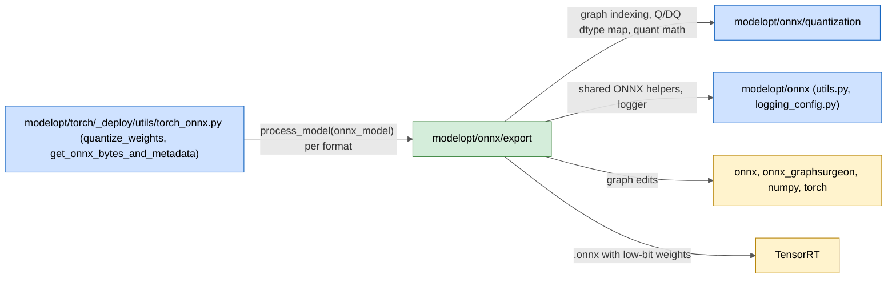
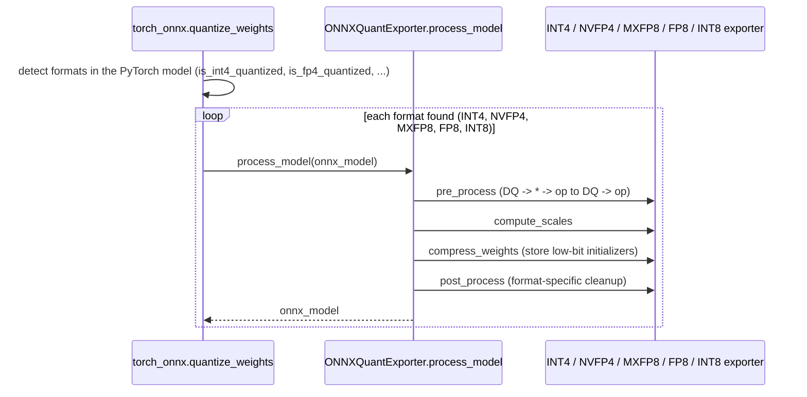

# modelopt/onnx/export

ONNX weight exporters: after a quantized PyTorch model is exported to ONNX with fake-quant Q/DQ nodes, these classes fold the weight Q/DQ into real low-bit weights (DQ only) so TensorRT can load a compact model.

## Purpose

- Turn fake-quant weight paths (`Q -> DQ` on FP32/FP16/BF16 weights) into stored low-bit initializers plus a `DequantizeLinear` for INT4, NVFP4, MXFP8 and FP8.
- Compute the weight scales each format needs (per-block INT4 and NVFP4 scales, E8M0 scales for MXFP8, FP8 scales).
- Rewrite graph patterns so TensorRT fuses them (FP8: move attention-scaling `Mul` and K-path `Transpose` before Q/DQ, add Q/DQ after `Softmax`, quantize unquantized Conv weights).
- Give one fixed four-step interface (`ONNXQuantExporter.process_model`) so the caller runs one exporter per format found in the model.
- Normalize weight paths that the Dynamo ONNX exporter writes (INT4, NVFP4 markers) into the TorchScript-style layout the exporters expect (`_dynamo_adapter.py`, private).

## Inter: interaction with other systems

## Components

| Component | Purpose |
|-----------|---------|
| `base_exporter.py` | `ONNXQuantExporter`: abstract `pre_process`, `compute_scales`, `compress_weights`, `post_process`; `process_model` runs them in order |
| `int4_exporter.py` | `INT4QuantExporter`: blockwise INT4 weight scales and packing |
| `nvfp4_exporter.py` | `NVFP4QuantExporter`: replace the FP4 Q/DQ with two DQ nodes (FP8 block scale, then FP4 weight) and cast weights to `FLOAT4E2M1` |
| `mxfp8_exporter.py` | `MXFP8QuantExporter`: E8M0 block scales and FP8 weights |
| `fp8_exporter.py` | `FP8QuantExporter`: fold weight Q/DQ to DQ only, plus FP8 graph rewrites for TensorRT fusion |
| `int8_exporter.py` | `INT8QuantExporter`: placeholder, every step returns the model unchanged |
| `_dynamo_adapter.py` | `normalize_dynamo_weight_paths()`: validate and normalize Dynamo-exported INT4/NVFP4 weight paths; not called by package code yet |
| `__init__.py` | Public exports of the six exporter classes |

## Intra: interaction between components

## Key integration tests

| Test | What it proves |
|------|----------------|
| `tests/unit/torch/quantization/test_onnx_export_cpu.py` | Quantized PyTorch model to ONNX on CPU |
| `tests/gpu/torch/quantization/test_onnx_export_cuda.py` | ONNX export of quantized models with CUDA |
| `tests/gpu/torch/quantization/test_nvfp4_onnx_export.py` | NVFP4 weights folded to two-DQ form |
| `tests/unit/onnx/quantization/test_fp8_mha_exporter.py` | FP8 attention rewrites (Mul, Transpose, Softmax Q/DQ) |
| `tests/unit/onnx/test_dynamo_adapter.py` | Dynamo weight-path normalization and refusals |
| `tests/unit/torch/quantization/test_dynamo_onnx_export.py` | Dynamo ONNX export of quantized models |
| `tests/examples/torch_onnx/test_torch_quant_to_onnx.py` | `examples/torch_onnx` end to end |
