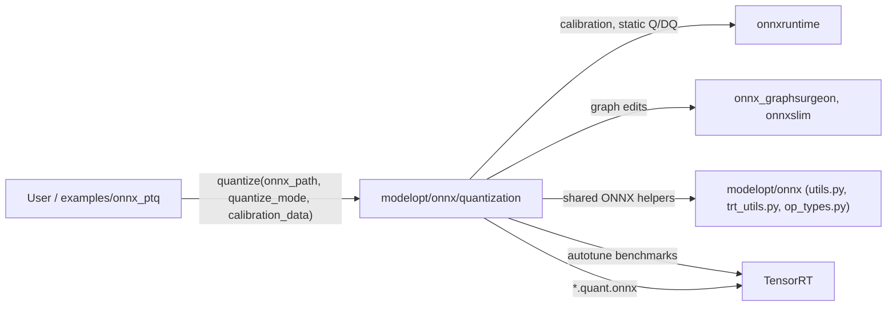
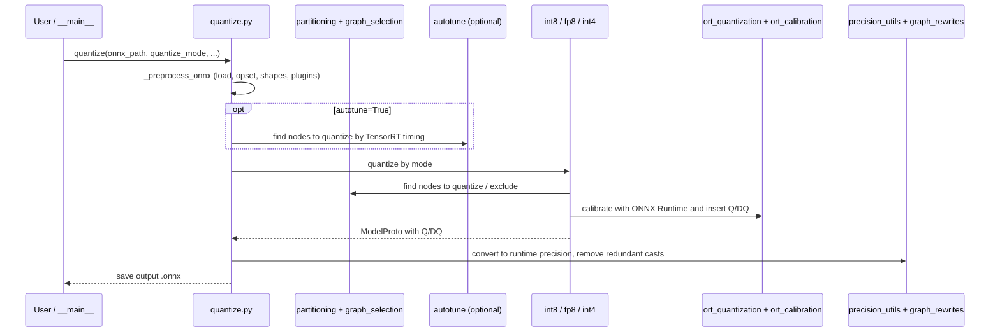

# modelopt/onnx/quantization

ONNX post-training quantization (PTQ): takes an ONNX model without Q/DQ nodes and calibration data, and writes an ONNX model with Q/DQ nodes for TensorRT.

## Purpose

- Quantize ONNX models to INT8, FP8 (calibrated Q/DQ) or INT4 (weight-only: RTN, AWQ clip, AWQ lite).
- Place Q/DQ nodes where TensorRT can fuse them: partition the graph into fusible regions and skip non-quantizable patterns.
- Calibrate activations with ONNX Runtime (`entropy` or `max`, optional per-node calibration) on CPU, CUDA or TensorRT execution providers.
- Convert non-quantized parts to the runtime precision (`fp16` or `bf16`).
- Support custom TensorRT plugins, DLA targets and dynamic input shape profiles.
- Optional autotune: measure Q/DQ placements with TensorRT and keep the fastest per region pattern. Without `timing_cache_file`, the TensorRT timing cache goes to a private temporary directory per process (`default_timing_cache_file()` in `autotune/benchmark.py`), not a shared `/tmp` path.
- CLI: `python -m modelopt.onnx.quantization` and `python -m modelopt.onnx.quantization.autotune`.

## Inter: interaction with other systems

## Components

| Component | Purpose |
|-----------|---------|
| `quantize.py` | Public `quantize()`: preprocess, select nodes, dispatch by mode, post-process, save |
| `__main__.py` | CLI for `quantize()` |
| `int8.py` | INT8 Q/DQ quantization |
| `fp8.py` | FP8 quantization (INT8 flow, then convert Q/DQ to FP8) |
| `int4.py` | INT4 weight-only quantization (RTN, AWQ clip, AWQ lite) |
| `partitioning.py` | Find fusible and non-quantizable partitions for Q/DQ placement |
| `graph_selection.py` | Select nodes to quantize or exclude; runtime probes |
| `graph_indexing.py` | Graph indexing and pattern matching |
| `graph_rewrites.py` | Shared graph rewrites (cast custom ops, remove redundant casts) |
| `qdq_graph.py`, `qdq_utils.py` | Q/DQ placement policy and Q/DQ node helpers |
| `operators.py` | Extra and changed QDQ operators on top of ONNX Runtime |
| `ort_quantization.py` | Static Q/DQ quantization built on ONNX Runtime |
| `ort_calibration.py`, `ort_calibration_per_node.py`, `ort_patches.py` | ONNX Runtime calibration patches |
| `ort_session.py`, `ort_utils.py` | Inference sessions and execution-provider setup |
| `calib_utils.py` | Calibration data readers and helpers |
| `precision_utils.py` | Convert non-quantized parts to `fp16` / `bf16` |
| `quant_utils.py` | Shared quantization math and helpers |
| `gs_patching.py` | `onnx_graphsurgeon` patch to set dtypes |
| `extensions.py`, `src/` | C++ extension for round-and-pack of INT4 weights; falls back to Python packing when the build fails (for example, no C++ compiler) |
| `autotune/` | Pattern-based Q/DQ autotuning with TensorRT benchmarks |

## Intra: interaction between components

## Key integration tests

| Test | What it proves |
|------|----------------|
| `tests/unit/onnx/quantization/test_quantize_api.py` | `quantize()` API across modes and options |
| `tests/unit/onnx/quantization/test_quantize_int8.py` | INT8 Q/DQ placement on sample graphs |
| `tests/unit/onnx/quantization/test_quantize_zint4.py` | INT4 weight-only quantization |
| `tests/unit/onnx/quantization/test_calibrated_quantization.py` | Calibration with data end to end |
| `tests/gpu/onnx/quantization/test_quantize_fp8.py` | FP8 quantization on GPU |
| `tests/gpu/onnx/quantization/test_plugin.py` | Models with custom TensorRT plugins |
| `tests/gpu/onnx/quantization/test_autotune_quantization_integration.py` | Autotune with TensorRT |
| `tests/unit/onnx/quantization/test_extensions.py` | INT4 packing falls back to Python when the extension build fails |
| `tests/examples/test_onnx_ptq.sh` | `examples/onnx_ptq` PTQ flow |

On Thor (aarch64), tests that need CUDA or TensorRT execution providers fail (see `.fork/known_failures.md`).
