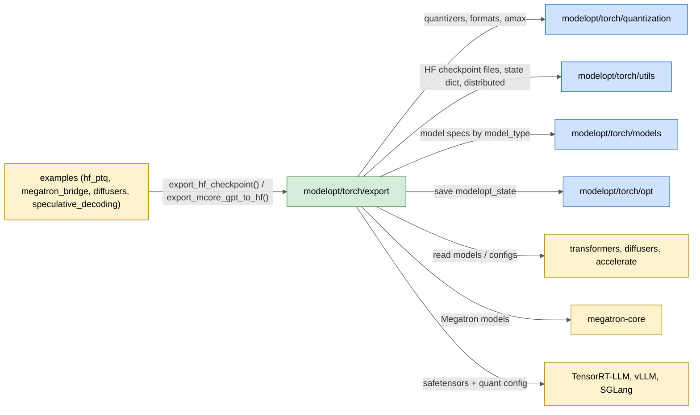
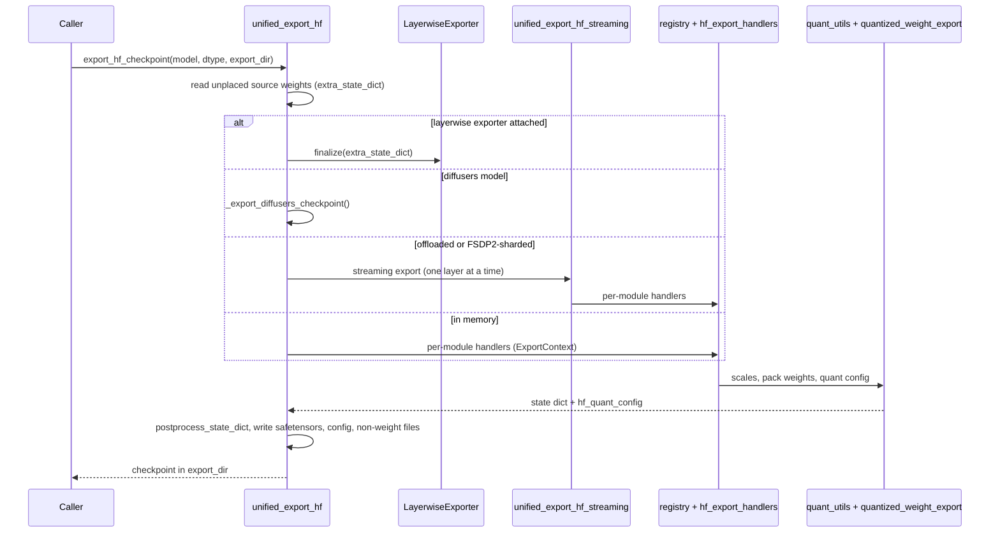

# modelopt/torch/export

Checkpoint export: writes a quantized (or pruned, or speculative-decoding) PyTorch model as a deployable checkpoint. The main format is the unified Hugging Face checkpoint (safetensors + `hf_quant_config.json` / `quantization_config`) that TensorRT-LLM, vLLM and SGLang load.

## Purpose

- Export Hugging Face `transformers` and `diffusers` models to a unified HF checkpoint (`export_hf_checkpoint()`): pack quantized weights, write scales, KV-cache scales and the quantization config.
- Export Megatron Core GPT models to an HF checkpoint (`export_mcore_gpt_to_hf()`), and import HF weights into Megatron Core (`import_mcore_gpt_from_hf()`), with per-model name mappings in `modelopt/torch/export/plugins/mcore_*.py`.
- Support the quantization formats of `modelopt.torch.quantization` (FP8, NVFP4, MXFP4/MXFP8, INT4 AWQ, INT8, W4A8, GGML/IQ formats and others; names in `quant_format.py`).
- Export large models in bounded memory: streaming export for offloaded and FSDP2-sharded models (`unified_export_hf_streaming.py`), and per-layer shards written during calibration (`layerwise_export.py`).
- Copy the source weights the model did not load (for example MTP heads) and non-weight files, so the checkpoint is the complete model.
- Export vLLM fake-quant checkpoints (HF and Megatron) and speculative-decoding draft models (EAGLE, DFlash) in their official formats.
- Keep the deprecated TensorRT-LLM checkpoint export in `trtllm/` (`export_tensorrt_llm_checkpoint()`, removal planned in 0.49.0).

## Inter: interaction with other systems

## Components

| Component | Purpose |
|-----------|---------|
| `unified_export_hf.py` | `export_hf_checkpoint()`: pick the path (diffusers, layerwise, streaming, FSDP2, in-memory), pack weights, write config; `export_speculative_decoding()` |
| `unified_export_hf_streaming.py` | Streaming export for offloaded and FSDP2 models: one layer at a time, then name shards and write the index |
| `layerwise_export.py` | `LayerwiseExporter`: write each decoder layer's shard as soon as it is calibrated, `finalize()` writes the rest |
| `unified_export_megatron.py` | `GPTModelExporter`, `export_mcore_gpt_to_hf()`, `import_mcore_gpt_from_hf()` |
| `registry.py` | `ExportModuleRegistry`, `PrepareMoEInputsRegistry`, `ExportContext`: dispatch per-module export logic |
| `hf_export_handlers.py` | Built-in handlers registered in `registry.py` (quantized linear, fused and MoE experts) |
| `quant_utils.py` | Scaling factors, quantization format of a module, weight packing (`to_quantized_weight()`), `postprocess_state_dict()` |
| `quantized_weight_export.py` | Functional export of quantized weight tensors and the HF quantization config |
| `quant_aware_conversion.py` | Quantization-aware reverse weight conversion (model layout back to HF layout) |
| `quant_format.py` | Quantization and KV-cache format names |
| `layer_utils.py` | Module-shape predicates and MoE quantizer helpers |
| `moe_utils.py` | MoE export helpers |
| `model_utils.py` | Model type detection |
| `convert_hf_config.py` | Convert the ModelOpt quant config to the llm-compressor format |
| `shard_cast_utils.py` | Shared primitives for streaming casts and shard writing |
| `diffusers_utils.py` | Diffusers component handling, NVFP4 padding and scale swizzle, per-layer metadata |
| `transformer_engine.py` | `convert_to_transformer_engine()` |
| `modelopt/torch/export/plugins/mcore_*.py`, `modelopt/torch/export/plugins/megatron_importer.py` | HF to Megatron Core name mappings per model family, and the importer |
| `modelopt/torch/export/plugins/vllm_fakequant_hf.py`, `modelopt/torch/export/plugins/vllm_fakequant_megatron.py` | vLLM fake-quant checkpoint export |
| `modelopt/torch/export/plugins/hf_spec_export.py`, `modelopt/torch/export/plugins/hf_spec_configs.py` | Speculative-decoding draft export and config templates |
| `trtllm/` | Deprecated TensorRT-LLM checkpoint export (`model_config_export.py` and helpers) |

## Intra: interaction between components

## Key integration tests

| Test | What it proves |
|------|----------------|
| `tests/unit/torch/export/test_unified_export_hf.py` | HF export on small models, CPU |
| `tests/unit/torch/export/test_export_registry.py` | Handler dispatch and precedence |
| `tests/unit/torch/export/test_quantized_weight_state.py` | Functional weight export state |
| `tests/unit/torch/export/test_quant_aware_conversion.py` | Reverse weight conversion |
| `tests/gpu/torch/export/test_unified_hf_export_and_check_safetensors.py` | Exported safetensors per format |
| `tests/gpu/torch/export/test_offload_export.py`, `test_fsdp2_export.py` | Streaming export for offloaded and FSDP2 models |
| `tests/gpu/torch/export/test_layerwise_export.py` | Per-layer export during calibration |
| `tests/gpu/torch/export/test_export_carry_over.py` | Unloaded source weights carried into the checkpoint |
| `tests/gpu/torch/export/test_export_diffusers.py` | Diffusers export |
| `tests/gpu_megatron/torch/export/test_unified_export_megatron.py` | Megatron Core export to HF |
| `tests/gpu_megatron/torch/export/test_vllm_fakequant_megatron_export.py` | vLLM fake-quant export from Megatron |
| `tests/gpu_trtllm/torch/export/test_export_compressed_nvfp4.py` | NVFP4 checkpoint loads in TensorRT-LLM |
