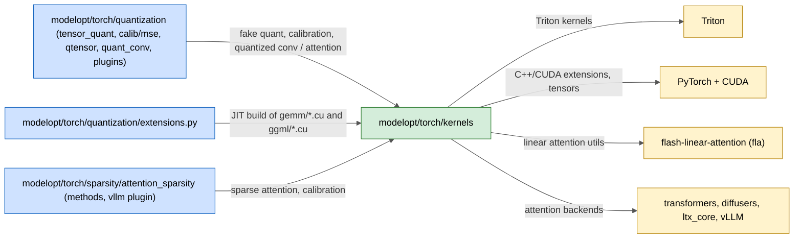
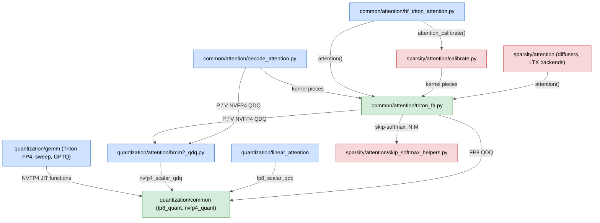

# modelopt/torch/kernels

ModelOpt kernel library: Triton kernels and CUDA C++ sources that the quantization and sparsity algorithms call on GPU. It has three groups: `common` (shared flash attention), `quantization` (fake-quant, GEMM, conv, GGML) and `sparsity` (skip-softmax sparse attention).

## Purpose

- Make fake quantization fast on GPU: FP8, NVFP4, MX and INT tensor quantization (Triton and CUDA), with composable Triton JIT functions for FP8 and NVFP4 that other kernels fuse in.
- Make calibration fast: fused NVFP4 FP8-scale sweep for weight-MSE calibration, and fused GPTQ blockwise weight update.
- Give one Triton flash attention (variable length, GQA, paged KV) that quantized and sparse attention reuse, plus a split-K decode attention for the paged NVFP4 serving path.
- Quantize special layers: Conv3D implicit GEMM with fused NVFP4 (see `quantization/conv/README.md`), linear attention (gated delta rule, based on `fla`), NVFP4 operands for the attention `P @ V` matmul.
- Pack and dequantize GGML formats (Q8_0, IQ1_S, IQ1_M, IQ2_XXS, IQ2_XS, IQ2_S) in CUDA.
- Sparse attention: skip-softmax and N:M sparse attention backends for HF, diffusers and LTX-2 models, and threshold calibration kernels.
- Load lazily: Triton kernels compile on first call, CUDA sources build as JIT C++ extensions (`modelopt/torch/quantization/extensions.py`).

## Inter: interaction with other systems

## Components

| Component | Purpose |
|-----------|---------|
| `common/attention/triton_fa.py` | Triton flash attention: variable length, GQA, paged KV |
| `common/attention/hf_triton_attention.py` | HF attention backend that uses `triton_fa` |
| `common/attention/decode_attention.py` | Split-K decode attention for the paged NVFP4 serving path |
| `quantization/common/fp8_quant.py`, `nvfp4_quant.py` | Composable Triton JIT functions for FP8 (E4M3) and NVFP4 (E2M1) fake quant |
| `quantization/gemm/tensor_quant*.cu`, `tensor_quant.cpp`, `tensor_quant*.h` | CUDA fake-quant extensions (INT, FP8, MX) |
| `quantization/gemm/fp4_kernel.py`, `fp4_kernel_hopper.py` | NVFP4 fake-quant Triton kernels (Hopper+ variant needs SM 8.9+); static blockwise kernel tiles 64 blocks per program with int64 offsets, so tensors above 2^31 elements (stacked MoE experts) work |
| `quantization/gemm/fp8_kernel.py` | FP8 Triton kernels |
| `quantization/gemm/nvfp4_fp8_sweep.py`, `_fp8_scale_candidates.py` | Fused NVFP4 weight-MSE FP8 scale sweep and its candidate set |
| `quantization/gemm/gptq_fused_kernel.py` | Fused GPTQ blockwise weight update |
| `quantization/conv/` | Conv3D implicit GEMM (BF16 WMMA, optional fused NVFP4) and its benchmark |
| `quantization/attention/bmm2_qdq.py` | NVFP4 operand helpers for attention BMM2 (`P @ V`) |
| `quantization/linear_attention/` | Gated delta rule chunk kernels (from `fla`) with quantization hooks |
| `quantization/ggml/` | CUDA pack/dequant for GGML Q8_0 and IQ1/IQ2 formats |
| `sparsity/attention/skip_softmax_helpers.py` | Skip-softmax and N:M sparse attention helpers |
| `sparsity/attention/calibrate.py` | Skip-softmax multi-threshold calibration kernel and API |
| `sparsity/attention/diffusers_triton_attention.py`, `ltx_triton_attention.py` | Sparse attention backends for diffusers and LTX-2 |
| `sparsity/gemm/` | Placeholder for sparse GEMM kernels |

## Intra: interaction between components

Arrows point from the caller to the module it imports.

`quantization/conv` and `quantization/ggml` are standalone: callers in `modelopt/torch/quantization` use them directly.

## Key integration tests

| Test | What it proves |
|------|----------------|
| `tests/unit/torch/kernels/common/attention/test_triton_fa.py` | Flash attention API and fallbacks, CPU-safe |
| `tests/gpu/torch/kernels/common/attention/test_triton_fa.py`, `test_triton_fa_paged.py` | Flash attention numerics, paged KV |
| `tests/gpu/torch/kernels/common/attention/test_triton_fa_p_qdq.py` | NVFP4 `P @ V` quantization inside attention |
| `tests/gpu/torch/kernels/common/attention/test_decode_attention.py` | Split-K decode attention |
| `tests/gpu/torch/kernels/quantization/conv/test_implicit_gemm.py` | Conv3D implicit GEMM against cuDNN |
| `tests/gpu/torch/kernels/quantization/linear_attention/test_fla_chunk_gated_delta_rule.py` | Gated delta rule kernel |
| `tests/gpu/torch/kernels/sparsity/attention/test_triton_fa_skip_softmax.py`, `test_triton_fa_sparse_nm.py` | Skip-softmax and N:M sparse attention |
| `tests/gpu/torch/kernels/sparsity/attention/test_triton_fa_calibrate.py` | Sparse attention threshold calibration |
| `tests/gpu/torch/quantization/test_tensor_quant_cuda.py` | CUDA fake-quant extensions |
| `tests/gpu/torch/quantization/test_nvfp4_fp8_sweep_kernel.py` | Fused NVFP4 FP8 scale sweep |
| `tests/gpu/_extensions/test_torch_kernels.py` | JIT build of the CUDA extensions |
