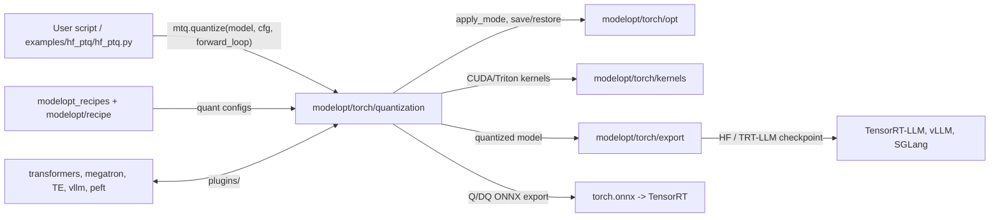
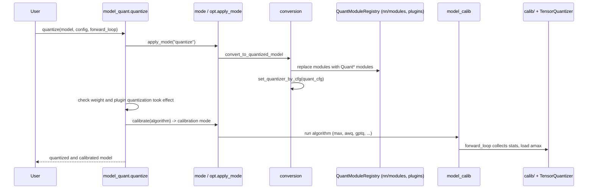

# modelopt/torch/quantization

PyTorch post-training quantization (PTQ) and quantization-aware training (QAT).

## Purpose

- Replace supported `nn.Module`s with quantized versions that hold `TensorQuantizer`s for inputs, weights and outputs.
- Apply a quantization config (`quant_cfg` list of wildcard entries + `algorithm`) to those quantizers.
- Calibrate scales (`amax`) with a forward loop: max, MSE, local Hessian, SmoothQuant, AWQ, SVDQuant, GPTQ, imatrix, LSQ.
- Search a per-layer format mix under a size or cost limit (`auto_quantize`), and a KV-cache format mix; both searches run under DP/FSDP2 and resume from per-rank checkpoints.
- Keep calibration correct when distributed or offloaded: synchronize `amax` across data-parallel ranks, and move quantizer state with weights under accelerate CPU offload.
- Simulate formats (fake quant) for INT8, INT4, FP8, NVFP4, MXFP4/MXFP8, NF4 and GGML formats; compress weights to real low-bit tensors.
- Save and restore the quantized state through the `modelopt.torch.opt` mode system (`mto.save` / `mto.restore`).
- Support third-party module types (Hugging Face, Megatron, Transformer Engine, vLLM, PEFT, and others) through plugins.

## Inter: interaction with other systems

## Components

| Component | Purpose |
|-----------|---------|
| `model_quant.py` | Public API: `quantize`, `calibrate`, `auto_quantize`, `enable_quantizer`, `disable_quantizer`, `fold_weight`, `print_quant_summary` |
| `config.py` | `QuantizeConfig`, quantizer attribute configs, algorithm configs, built-in format presets |
| `mode.py` | Mode descriptors for `quantize`, `real_quantize`, `quantize_export`, `auto_quantize` and one calibration mode per algorithm |
| `conversion.py` | Module replacement through `QuantModuleRegistry`, apply `quant_cfg` to quantizers, restore quantizer state |
| `model_calib.py` | Calibration algorithms (max, MSE, local Hessian, SmoothQuant, AWQ, SVDQuant, GPTQ, imatrix, LSQ, layerwise); `amax` sync across DP/EP ranks |
| `algorithms.py`, `_auto_quantize_cost.py`, `_auto_quantize_shapley.py` | `auto_quantize` search: candidate formats, cost model, sensitivity scores |
| `kv_cache_auto_quant.py` | KV-cache format search for `auto_quantize`; DP/FSDP2 (global KL reduction, rank-0 recipe broadcast) and per-rank checkpoint resume; rejects TP/EP before conversion |
| `nn/modules/` | `TensorQuantizer` and quantized modules (linear, conv, RNN, norm, embedding, pooling, activations) |
| `nn/functional.py` | Quantization-aware functional ops |
| `tensor_quant.py` | Fake-quant autograd functions for each format |
| `calib/` | Calibrators: max, histogram, MSE, bias, NVFP4 activation headroom |
| `qtensor/` | Real quantized tensor types (INT4, INT8, FP8, NVFP4, MXFP4, MXFP8, NF4) |
| `compress.py` | Convert fake-quant weights to real `qtensor` storage |
| `backends/` | Real low-bit GEMM registry (FP8 per-tensor, NVFP4) |
| `ggml/` | GGML formats (Q8_0, IQ1/IQ2 codebooks), GPTQ and imatrix for GGML |
| `linear_attention/` | Helpers for linear-attention modules |
| `lora.py` | LoRA adapters on quantized models |
| `export_onnx.py`, `_dynamo_onnx.py` | Q/DQ symbolic functions for ONNX export |
| `extensions.py` | Build and load CUDA extensions (`precompile()`) |
| `plugins/` | Quantized module types for third-party libraries |
| `utils/` | Shared helpers: calibration, numeric, layerwise (GPTQ Hessian memory headroom, batch-size probe), shared inputs (shared ranges for MLA fused down-projection) |
| `modelopt/torch/quantization/plugins/accelerate.py` | Accelerate CPU-offload support: quantizer state moves on and off the GPU with the weights |

## Intra: interaction between components

## Key integration tests

| Test | What it proves |
|------|----------------|
| `tests/unit/torch/quantization/test_quantize_cpu.py` | End-to-end `quantize` with built-in configs on CPU; module training mode restored after calibration |
| `tests/gpu/torch/quantization/test_quantize_cuda.py` | End-to-end `quantize` with CUDA kernels |
| `tests/unit/torch/quantization/test_autoquant.py` | `auto_quantize` search and config output |
| `tests/unit/torch/quantization/test_calib.py` | Calibration algorithms (max, SmoothQuant, AWQ) |
| `tests/gpu/torch/quantization/test_real_quantize_cuda.py` | Compress to real quantized weights and run inference |
| `tests/gpu/torch/quantization/test_fsdp2.py` | Quantization with FSDP2-sharded models |
| `tests/gpu/torch/quantization/test_fsdp2_autoquant.py` | Weight, KV-only and composed `auto_quantize` under FSDP2, with checkpoint resume (needs 2 GPUs) |
| `tests/unit/torch/quantization/test_kv_cache_auto_quant_distributed.py` | Distributed KV-cache search and resume parity (CPU, Gloo) |
| `tests/unit/torch/quantization/test_dist.py`, `tests/gpu/torch/quantization/test_amax_sync_distributed.py` | `amax` synchronization under data-parallel calibration |
| `tests/gpu/torch/quantization/test_layerwise_calibrate.py`, `tests/gpu/torch/quantization/plugins/test_accelerate_gpu.py` | Layerwise GPTQ calibration and offloaded quantizer state |
| `tests/unit/torch/quantization/plugins` | Third-party plugins (Hugging Face, PEFT, and others) |
| `tests/examples/hf_ptq/test_llm_ptq.py` | Full LLM PTQ example and checkpoint export |
| `tests/examples/torch_onnx/test_torch_quant_to_onnx.py` | Quantized PyTorch model to Q/DQ ONNX |

On Thor, run GPU tests in `mo-dev` and precompile extensions first (see `.fork/known_failures.md`).
