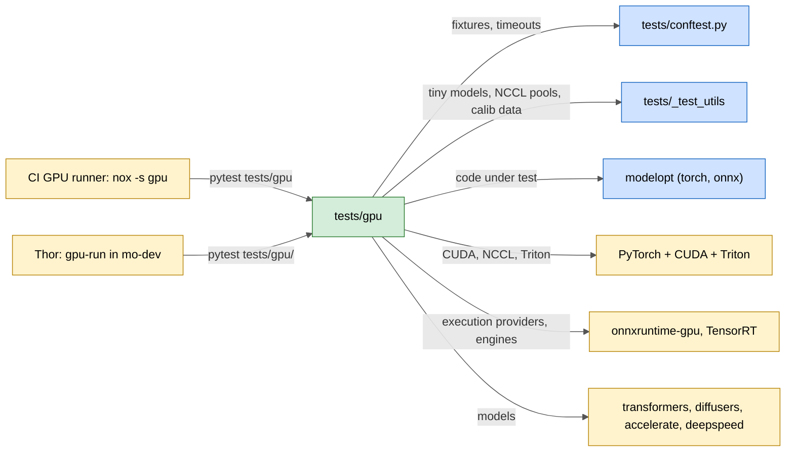
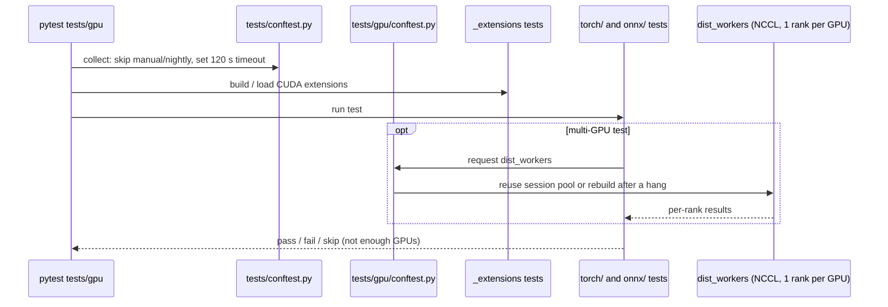

# tests/gpu

Fast GPU tests for the core ModelOpt library: CUDA and Triton kernels, real GPU calibration and export, multi-GPU (NCCL) paths, and ONNX Runtime / TensorRT runs. Framework-specific GPU tests are in the sibling folders `tests/gpu_megatron`, `tests/gpu_trtllm` and `tests/gpu_vllm`.

## Purpose

- Check the code paths that need CUDA: fake-quant kernels, JIT CUDA extensions, real quantized GEMMs, FSDP2/DDP/DeepSpeed calibration, offloaded and layerwise export.
- Check multi-GPU behavior with one NCCL worker per visible GPU (`dist_workers` fixture); tests that need 2 GPUs skip on a 1-GPU runner.
- Check ONNX quantization with CUDA / TensorRT execution providers and TensorRT builds.
- Apply a default per-test timeout of 120 s (`_DEFAULT_TIMEOUT` in `tests/conftest.py`).
- Run in CI through `nox -s gpu`, which installs `.[all,dev-test,dev-fla]` plus source-built CUDA wheels, then runs `pytest tests/gpu`.

## Inter: interaction with other systems

## Components

| Component | Purpose |
|-----------|---------|
| `conftest.py` | `dist_workers` (session NCCL pool, one rank per GPU, rebuilt after a hang) and `calib_jsonl` (local calibration texts) fixtures |
| `_extensions/` | JIT build and load of the CUDA extensions (torch quantization, kernels, ONNX INT4 packing) |
| `torch/quantization/` | CUDA fake quant, real quantization, calibration (GPTQ, LSQ, layerwise), FSDP/FSDP2/DeepSpeed, KV-cache and weight `auto_quantize` under FSDP2, ONNX export of quantized models |
| `torch/export/` | HF, diffusers, offloaded, FSDP2 and layerwise checkpoint export |
| `torch/kernels/` | Triton flash attention, decode attention, Conv3D implicit GEMM, linear attention, sparse attention kernels |
| `torch/sparsity`, `torch/speculative`, `torch/distill`, `torch/nas`, `torch/prune`, `torch/puzzletron`, `torch/fastgen`, `torch/opt`, `torch/models`, `torch/deploy`, `torch/utils` | GPU tests per `modelopt/torch` subpackage |
| `onnx/` | ONNX quantization with GPU providers (FP8, INT4 AWQ, plugins, autotune), ORT calibration, simplify, TensorRT utils |

## Intra: interaction between components

## Key integration tests

| Test | What it proves |
|------|----------------|
| `tests/gpu/_extensions/test_torch_extensions.py`, `test_torch_kernels.py` | CUDA extensions build and load |
| `tests/gpu/torch/quantization/test_quantize_cuda.py` | End-to-end quantization with CUDA kernels |
| `tests/gpu/torch/quantization/test_tensor_quant_cuda.py` | Fake-quant kernels per format |
| `tests/gpu/torch/quantization/test_fsdp2_autoquant.py` | Weight and KV `auto_quantize` under FSDP2 with resume (2 GPUs) |
| `tests/gpu/torch/quantization/test_amax_sync_distributed.py` | `amax` sync across ranks |
| `tests/gpu/torch/export/test_unified_hf_export_and_check_safetensors.py` | Exported safetensors per format |
| `tests/gpu/torch/export/test_offload_export.py` | Streaming export of CPU-offloaded models |
| `tests/gpu/torch/kernels/common/attention/test_triton_fa.py` | Triton flash attention numerics |
| `tests/gpu/onnx/quantization/test_quantize_fp8.py` | ONNX FP8 quantization on GPU |

On Thor: run with `~/agent-docs/gpu/gpu-run -- pytest tests/gpu/<area>` (inside `mo-dev`), precompile extensions first, and expect the failures in `.fork/known_failures.md` (CPU-only onnxruntime on aarch64, DeepSpeed NVML, `test_trt_utils.py` only alone).
