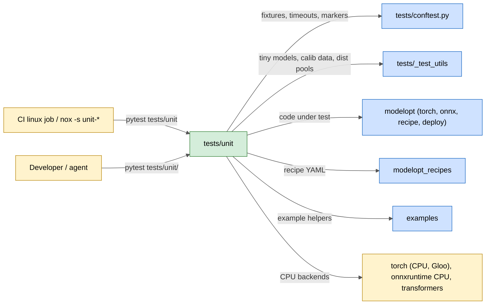
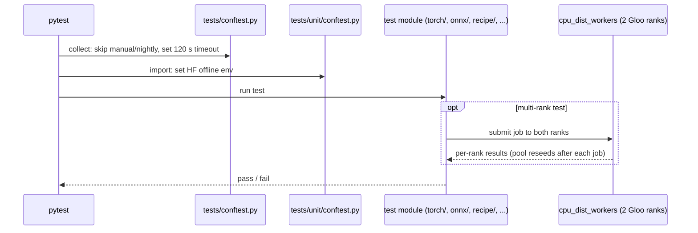

# tests/unit

Fast, CPU-only, offline tests for the core ModelOpt library. CI runs the whole folder serially in the `linux` job (20-minute limit), so each test must stay well under 5 s.

## Purpose

- Check the public APIs and the internal logic of `modelopt` (torch, onnx, recipes, deploy) without a GPU.
- Run hermetic: `tests/unit/conftest.py` sets `HF_HUB_OFFLINE`, `HF_DATASETS_OFFLINE` and `TRANSFORMERS_OFFLINE`; tests build tiny models and tokenizers locally (`tests/_test_utils`).
- Give multi-rank CPU coverage (DP sync, distributed search) through two persistent Gloo ranks (`cpu_dist_workers` fixture), not a spawn per test.
- Check example helper code and recipes (YAML files in `modelopt_recipes`) that need no GPU.
- Apply a default per-test timeout of 120 s (`_DEFAULT_TIMEOUT` in `tests/conftest.py`); `manual` and `nightly` tests are skipped unless `--run-manual` / `--run-nightly` is given.

## Inter: interaction with other systems

## Components

| Component | Purpose |
|-----------|---------|
| `conftest.py` | Force Hugging Face offline mode; `cpu_dist_workers` fixture (two Gloo ranks shared by the session) |
| `torch/` | Tests per `modelopt/torch` subpackage (`quantization`, `export`, `opt`, `kernels`, `nas`, `prune`, `puzzletron`, `sparsity`, `speculative`, `distill`, `fastgen`, `deploy`, `trace`, `utils`, `models`) |
| `onnx/` | ONNX quantization, autocast, graph surgery, Dynamo adapter, partitioning, ONNX utils |
| `recipe/` | Recipe loader, presets and per-model recipe checks |
| `examples/` | CPU checks of example scripts (diffusers FP4, Kimi-K3, DeepSeek-V4 recipe, speculative decoding entry point) |
| `deploy/` | `modelopt/deploy` smoke test |
| `tools/` | `tools` helpers (resource monitor) |
| `test_example_run_command.py`, `test_diffusers_example_runner.py` | Example command builders and runners |

## Intra: interaction between components

## Key integration tests

| Test | What it proves |
|------|----------------|
| `tests/unit/torch/quantization/test_quantize_cpu.py` | End-to-end `mtq.quantize` with built-in configs on CPU |
| `tests/unit/torch/quantization/test_dist.py` | `amax` sync under data-parallel calibration (Gloo) |
| `tests/unit/torch/quantization/test_kv_cache_auto_quant_distributed.py` | Distributed KV-cache search and checkpoint resume |
| `tests/unit/torch/export/test_unified_export_hf.py` | HF checkpoint export on small models |
| `tests/unit/torch/opt/test_chaining.py` | Stacking modes and save/restore |
| `tests/unit/onnx/quantization/test_quantize_api.py` | ONNX `quantize()` API across modes |
| `tests/unit/onnx/autocast/test_autocast.py` | ONNX FP16/BF16 autocast |
| `tests/unit/recipe/test_loader.py` | Recipe loading |

Run one area for fast feedback, for example `pytest tests/unit/torch/quantization`. On Thor, run them in `~/.venvs/mo` or `mo-dev`; ONNX tests that need CUDA or TensorRT execution providers do not belong here.
